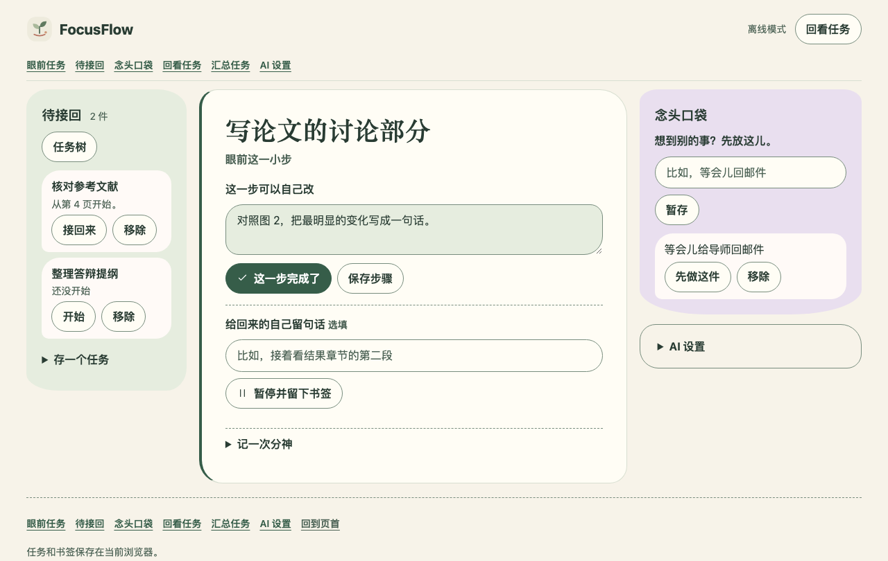

<p align="center"></p>
<h1 align="center">FocusFlow</h1>
<p align="center"><strong>开始不了的时候，先找一小步。<br />被打断以后，留一个能回来的地方。</strong></p>
<p align="center">A small next step. A place to come back to.</p>
<p align="center"><a href="https://anyan001121-dot.github.io/focusflow/try/">在线体验 / Try the demo</a> · <a href="#english">English</a> · <a href="docs/before-after.md">使用前与使用后</a> · <a href="docs/development.md">安装与开发</a></p>

## 也许你遇到过这样的时刻

文档已经打开很久，第一句话还没写。脑子里同时挂着论文、邮件和明天的面试，哪一件都想做，哪一件都没开始。

好不容易做了一会儿，一条消息把你带走。等你回来，又要花力气想：我刚才做到哪里了？

FocusFlow 想在这些具体的时刻帮一点忙。你可以把没整理好的想法写下来，先看一个能动手的小步骤。突然想起别的事，就先记在旁边。需要离开的时候，保存当前的位置，回来再接着做。

**你不用先把自己调整到“能专注”的状态，才有资格使用这个工具。** 今天只能做一点，也可以从这一点开始。

## 它适合谁？

需要独立完成学习或工作，已经知道大概要做什么，却常常卡在开始、或者中断后难以返回的成年人。

我们特别关注 ADHD 用户的使用困难，也欢迎因忙乱、疲惫或其他原因难以专注的人。你不需要提供诊断，也不需要解释自己为什么卡住。每个人需要的帮助不同，可以只用对你有用的部分。

## 使用前与使用后，会有什么不同？

下面是场景示例，描述工具能提供的支持，不是真实用户证言或效果保证。

| 此刻可能发生的事 | FocusFlow 能帮你做的事 | 仍然由你决定 |
| --- | --- | --- |
| “我要写论文。”任务太大，不知道从哪儿碰起 | 给一个单独显示、可以编辑的第一步 | 这一步是否合适，想从哪里开始 |
| 写着写着想起另一封邮件，怕忘就想切过去 | 把这件事暂存，保留原来的步骤 | 什么时候处理；有急事可以先暂停 |
| 开会回来，忘了刚才停在哪里 | 保存目标、步骤和可选的返回提示 | 什么时候回来，不需要补打卡 |
| 做完一小段，却离整个目标还很远 | 记录完成的小步骤，不把它说成整件事已完成 | 继续下一件事，或今天先停在这里 |

[看看完整的一天：开始论文 → 想起邮件 → 暂停 → 回来继续](docs/before-after.md)

## 先试一次就好

打开[网页版工作台](https://anyan001121-dot.github.io/focusflow/try/)，直接用离线模板开始。桌面左边是待接回，中间是眼前任务，右边是念头口袋和回看。手机先显示当前任务，页首和页尾都有导览。



1. **先做一小步。** 写下任务，点「出发咯」。第一步可以自己改，当前步骤和返回提示的草稿刷新后也能接着写。
2. **需要切走时，给自己留个位置。** 想到别的事就先放进念头口袋。如果要现在做，点「先做这件」，原任务的步骤和书签会一起保存。回来点「接回来」。
3. **想知道推进了多少，就回看一下。** 每点一次「这一步完成了」，就记下一步。任务结束后，可以看到完成的小步、自己记下的分神原因、结果和「下次试试」。

有几件事在手上时，可以先存到「待接回」，用任务树加子任务或找回书签。点「回看任务」可以查看别的任务，也可以勾选几件事，在本地汇总已有结果、停在哪儿和下一步。[工作台用法与后续规划](docs/workbench-roadmap.md)

想要更贴合任务的第一步时，可以在「AI 设置」接入自己的接口。网页只在你点「出发咯」时发送任务和补充提示。接口失败时会给出离线建议。

## 我们希望它怎样陪你做事

- **少一点选择负担。** 聚焦当前步骤，其他内容按需展开。
- **休息有位置。** 暂停不是失败，也不会清空已经做过的部分。
- **回来不需要解释。** 不问“怎么又分心了”，直接把留下的位置给你。
- **不替你判断努力够不够。** 没有连续签到要求，也不把未完成轮次直接叫作放弃。

这些是设计选择，不是已经证实的干预效果。FocusFlow 仍是一个在完善中的原型。

## 数据会放在哪里？

**GitHub Pages 网页版**把任务、念头、草稿和回顾存在当前浏览器。用同一浏览器刷新可以恢复，换设备或清除站点数据后需要重新开始。AI 接口地址、令牌和补充提示只保留在当前页面。

**Python / Streamlit 版**在本地单人运行时使用 SQLite。自行公开部署 Streamlit 时，应启用多会话隔离，临时会话的恢复取决于部署配置。[详细说明与配置](docs/development.md#privacy-and-deployment)

FocusFlow 不诊断或治疗 ADHD，也不提供医疗建议。

## 在自己电脑上运行

只想本机体验网页，可以在项目目录执行 `python3 -m http.server 8000 --directory docs`，再打开 `http://127.0.0.1:8000/try/`。运行 Streamlit 版需要 Python 3.11 或以上版本：

```bash
git clone https://github.com/anyan001121-dot/focusflow.git
cd focusflow
python -m venv .venv
# macOS / Linux
source .venv/bin/activate
# Windows PowerShell: .venv\Scripts\Activate.ps1
pip install -r requirements.txt
streamlit run app.py
```

[接入 AI、部署、测试与架构说明](docs/development.md) · [产品走查与真实用户验证计划](docs/product-review-2026-09-16.md)

## English

### When knowing what to do isn't enough to begin

The document is open. You know the work matters. But you keep moving between tabs, and the first sentence is still unwritten. Or a message interrupts you, and coming back means figuring out where you left off all over again.

FocusFlow is for those moments. Write down a task in your own words. See one small next step with a clear stopping point. Park another thought without losing the current task. If you need a break, save your place and return when you're ready.

It's designed for adults who struggle to start or return to study and work, with particular attention to ADHD users. You don't need a diagnosis to use it. You can use whichever parts help.

### Before and with FocusFlow

These are illustrative situations, not measured results or testimonials.

| Without a place to keep your next step | With FocusFlow |
| --- | --- |
| A large goal sits on a list: “write my paper” | One suggested action you can edit |
| Another thought pulls you into a different task | A place to save it while keeping the current step |
| Returning from a break means rebuilding the context | Your saved step and an optional note from before the break |
| A short session feels unfinished | A record of the steps you took, without claiming the whole goal is done |

Pause whenever you need. When you return, pick up from the step and note you left yourself.

Practice mode works without an API key and uses templates. Connected AI suggestions may be more specific, but can still miss the context. Completing suggested steps is not proof of completing the larger real-world goal. We haven't established that FocusFlow improves ADHD symptoms or task outcomes.

### Run, connect, and contribute

Use the installation commands above. The [development guide](docs/development.md) covers AI configuration, persistence, public deployment, and tests. The [scenario guide](docs/before-after.md) walks through the intended experience and its limits.

The [browser workbench](https://anyan001121-dot.github.io/focusflow/try/) saves tasks, drafts, bookmarks, and recaps in the current browser. Use the task tree to revisit branches, or select several tasks to generate an offline summary. An optional AI endpoint receives the task and extra prompt when you start a new task from the home form. The separate Streamlit app uses local SQLite in single-user mode.

If you try it, useful feedback is very concrete: **What were you trying to do? Which step helped you act, or made you stop?** You don't need to share private task content or medical information.

[MIT license](LICENSE)


## 最新更新 / Latest update

网页版新增三栏工作台、任务树、自动保存草稿、任务回顾和多任务汇总。[查看工作台说明](docs/workbench-roadmap.md)

The browser release adds a three-column workbench, a task tree, autosaved drafts, completion recaps, and summaries of selected tasks. The [previous Streamlit release notes](docs/release-2026-11-06.md) cover portable return files and step editing.
